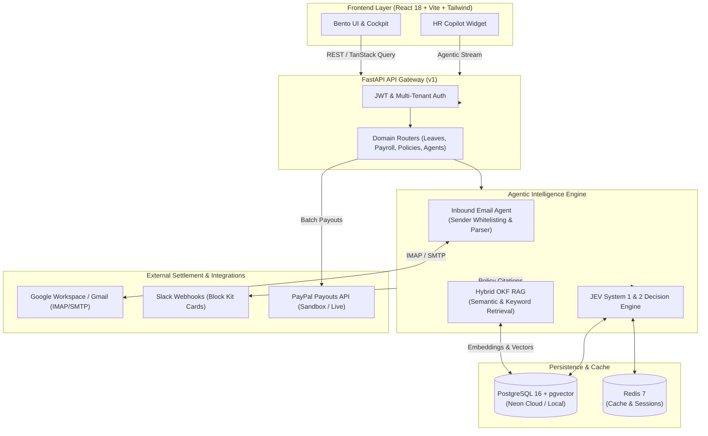

# Leavify.ai

<div align="center">

**Autonomous Multi-Agent AI Leave Intelligence & Payroll Automation Platform**

[](https://fastapi.tiangolo.com)
[](https://react.dev)
[](https://www.typescriptlang.org)
[](https://tailwindcss.com)
[](https://github.com/pgvector/pgvector)
[](https://developer.paypal.com)
[](https://www.docker.com)
[](LICENSE)

</div>

---

## 📌 Overview

**Leavify.ai** is a multi-tenant, agentic AI copilot platform engineered to automate organizational HR workflows, leave policy compliance, employee queries, and cross-border payroll settlements.

Combining multi-provider LLM orchestration with high-speed deterministic decision rails (JEV System 1 & System 2), **Leavify.ai** eliminates manual administrative bottlenecks by reading inbound employee requests over Gmail/IMAP, cross-referencing organizational knowledge files (OKF) via vector similarity search, calculating leave balances, and orchestrating batch payouts through the PayPal Payouts API.

---

## ✨ Key Capabilities

### 1. 🤖 Autonomous Multi-Agent Orchestration
- **Policy & Leave Copilot**: Evaluates leave applications using deterministic rules (System 1) combined with LLM reasoning (System 2) to prevent quota overages and scheduling deadlocks.
- **Inbound Communication Agent**: Continuously polls corporate inboxes via IMAP, applies an email sender whitelist to drop spam and non-employee mail, extracts leave intent with date parsing, and records structured applications automatically.
- **Multi-Channel Notification Dispatcher**: Sends notifications via SMTP email and Slack Block Kit cards featuring one-click approval workflows.

### 2. 📚 Hybrid OKF & Policy Knowledge Base (RAG)
- **Vector Search with `pgvector`**: Embeds company handbooks, compliance policies, and contractual documents using high-dimensional text embeddings (`text-embedding-004` / `text-embedding-3-small`).
- **Hybrid Keyword & Semantic Retrieval**: Merges lexical BM25-style keyword matching with cosine similarity search for pinpoint citation accuracy during policy evaluations.

### 3. 💳 Payroll Execution & PayPal Payouts Settlement
- **Automated Batch Aggregation**: Consolidates employee monthly base commitments and proration adjustments into auditable batch ledgers.
- **Direct Rail Integration**: Dispatches batch payouts directly through the **PayPal Payouts REST API** (`/v1/payments/payouts`), tracking settlement statuses (`PENDING`, `SUCCESS`, `FAILED`) in real time.

### 4. 🏢 Multi-Tenant Isolation & Role-Based Security
- **Strict Data Segregation**: Enforces cryptographic and query-level tenant boundary isolation via `company_id` across all ORM models.
- **Three-Tier RBAC**: Granular permissions across `Super Admin`, `HR Manager`, and `Employee` personas.
- **Secure Vault**: AES-encrypted credential management for API tokens, SMTP passwords, and external webhooks.

### 5. 🎨 Human-Crafted Editorial UI
- **Unslop Design Standard**: Custom Swiss/Bento visual architecture with warm obsidian (`#0c0a09`), warm stone cards (`#141210`), cream typography (`#FAF8F5`), and crisp terracotta/orange accents (`#ea580c`).
- **Real-Time Interactive Panels**: Live metric cards, leave quota gauges, interactive approval cockpit, and conversational HR Assistant chatbot with quick prompts.

---

## 🏛 Architecture



---

## 🛠 Technology Stack

| Domain | Technologies |
| :--- | :--- |
| **Backend Framework** | [FastAPI](https://fastapi.tiangolo.com/) 0.115, [Uvicorn](https://www.uvicorn.org/), [Pydantic v2](https://docs.pydantic.dev/) |
| **AI & LLM Routing** | [LangGraph](https://github.com/langchain-ai/langgraph), Multi-Provider Fallback (OmniRoute, OpenRouter, Google Gemini, Grok/xAI, Local Ollama) |
| **Database & ORM** | [PostgreSQL 16](https://www.postgresql.org/) with [pgvector](https://github.com/pgvector/pgvector), [SQLAlchemy 2.0 (Async)](https://www.sqlalchemy.org/), [Alembic](https://alembic.sqlalchemy.org/) |
| **Caching & Queue** | [Redis 7](https://redis.io/) |
| **Frontend Framework** | [React 18](https://react.dev/), [TypeScript](https://www.typescriptlang.org/), [Vite](https://vitejs.dev/) |
| **UI & Styling** | [Tailwind CSS 3.4](https://tailwindcss.com/), [Lucide React](https://lucide.dev/), [Recharts](https://recharts.org/), Custom Tokens (`tokens.css`) |
| **State & Data Fetching**| [Zustand](https://github.com/pmndrs/zustand), [TanStack React Query v5](https://tanstack.com/query/latest) |
| **Payments Rail** | [PayPal Payouts API v1](https://developer.paypal.com/docs/api/payments.payouts-batch/v1/) |
| **Communication** | IMAP (Inbound email polling), SMTP (Outbound email), Slack Webhooks |

---

## 📂 Repository Layout

```text
Workforce/
├── backend/
│   ├── alembic/                # Database migrations
│   ├── app/
│   │   ├── core/               # Security, tokens, and middleware
│   │   ├── modules/
│   │   │   ├── agents/         # LangGraph workflows & inbound email worker
│   │   │   ├── auth/           # Multi-tenant registration & JWT login
│   │   │   ├── departments/    # Department configurations
│   │   │   ├── employees/      # Employee records & credentials
│   │   │   ├── leaves/         # Leave requests & quota policies
│   │   │   ├── notifications/  # Email and Slack alerts
│   │   │   ├── payments/       # PayPal Payouts integration
│   │   │   ├── payroll/        # Payroll batches and ledger computation
│   │   │   └── policies/       # OKF knowledge base & pgvector embeddings
│   │   ├── config.py           # Pydantic environment settings
│   │   ├── database.py         # Async SQLAlchemy & Redis connections
│   │   └── main.py             # FastAPI entrypoint & router mounts
│   ├── tests/                  # Pytest async test suite
│   ├── Dockerfile              # Backend container definition
│   └── requirements.txt        # Python dependencies
├── frontend/
│   ├── src/
│   │   ├── components/         # Reusable UI widgets & HR Assistant chatbot
│   │   ├── pages/
│   │   │   ├── auth/           # Login & Registration
│   │   │   ├── dashboard/      # Bento metrics & activity ledger
│   │   │   ├── employees/      # Directory & salary records
│   │   │   ├── hr/             # Approval Cockpit
│   │   │   ├── leaves/         # Leave tracking & policy balances
│   │   │   ├── payroll/        # Payroll execution & PayPal disbursement
│   │   │   └── policies/       # Policy knowledge editor
│   │   ├── tokens.css          # Design system color tokens & variables
│   │   └── App.tsx             # Route definitions & React Query provider
│   ├── package.json            # Node dependencies & Vite build scripts
│   └── tailwind.config.js      # Bespoke palette configurations
├── docker-compose.yml          # Container orchestration (API, DB, Redis, UI)
├── .env.example                # Documented configuration template
└── README.md                   # Project documentation
```

---

## 🚀 Quick Start Guide

### Prerequisites
- **Python**: `3.12+`
- **Node.js**: `18.x` or `20.x` (with `npm`)
- **Docker & Docker Compose** (Optional, for containerized run)
- **PostgreSQL 16** with the `pgvector` extension enabled

---

### Option A: Running with Docker Compose (Recommended)

1. **Clone the repository**:
   ```bash
   git clone https://github.com/your-org/workforce.git
   cd Workforce
   ```

2. **Configure Environment**:
   ```bash
   cp .env.example .env
   # Edit .env with your LLM API keys and database credentials
   ```

3. **Launch All Services**:
   ```bash
   docker compose up --build -d
   ```

4. **Verify Health**:
   - Web Application: `http://localhost:3000`
   - FastAPI Docs: `http://localhost:8000/docs`
   - Healthcheck: `http://localhost:8000/health`

---

### Option B: Local Manual Setup

#### 1. Backend Setup

```bash
cd backend

# Create and activate a virtual environment
python -m venv .venv
# On Windows:
.\.venv\Scripts\activate
# On Linux/macOS:
source .venv/bin/activate

# Install dependencies
pip install -r requirements.txt

# Run database migrations
alembic upgrade head

# Start FastAPI development server
uvicorn app.main:app --host 0.0.0.0 --port 8000 --reload
```

#### 2. Frontend Setup

```bash
cd frontend

# Install dependencies
npm install

# Start Vite dev server
npm run dev
```

The application will be accessible at `http://localhost:5173` (or `http://localhost:3000`).

---

## ⚙️ Environment Configuration

Copy `.env.example` to `.env` and configure the desired parameters:

| Variable | Description | Default |
| :--- | :--- | :--- |
| `DATABASE_URL` | Async PostgreSQL connection string with `pgvector` | `postgresql+asyncpg://...` |
| `REDIS_URL` | Redis connection URL | `redis://localhost:6379/0` |
| `SECRET_KEY` | Secret key for JWT hashing (min 32 chars) | — |
| `LLM_ROUTING_ORDER` | Priority list for model fallbacks | `omniroute,openrouter,gemini,grok,local` |
| `GEMINI_API_KEY` | Google Gemini API key for policy synthesis | — |
| `PAYPAL_MODE` | PayPal environment (`sandbox` or `live`) | `sandbox` |
| `PAYPAL_CLIENT_ID` | PayPal developer client ID | — |
| `PAYPAL_CLIENT_SECRET` | PayPal developer secret | — |
| `IMAP_HOST` / `IMAP_USER` | Inbound Gmail IMAP server & app user | `imap.gmail.com` |
| `IMAP_PASSWORD` | Google 16-character App Password | — |
| `SLACK_WEBHOOK_URL` | Slack incoming webhook URL for approval cards | — |

---

## 🧪 Testing & Verification

Run the comprehensive async test suite to verify agent logic, isolation barriers, and anti-spam filters:

```bash
# In the repository root
$env:PYTHONPATH="backend"
.\backend\.venv\Scripts\python.exe -m pytest backend/tests/ -v
```

To verify frontend TypeScript types and production builds:

```bash
cd frontend
npm run build
```

---

## 📄 License

This project is licensed under the [MIT License](LICENSE).
