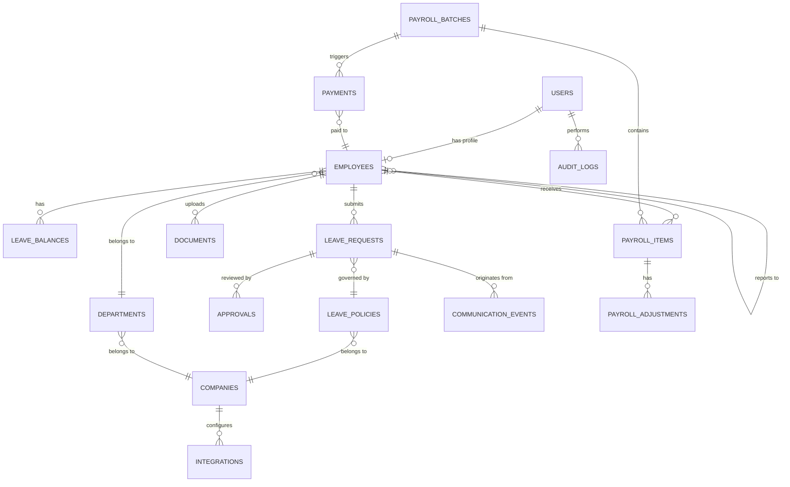
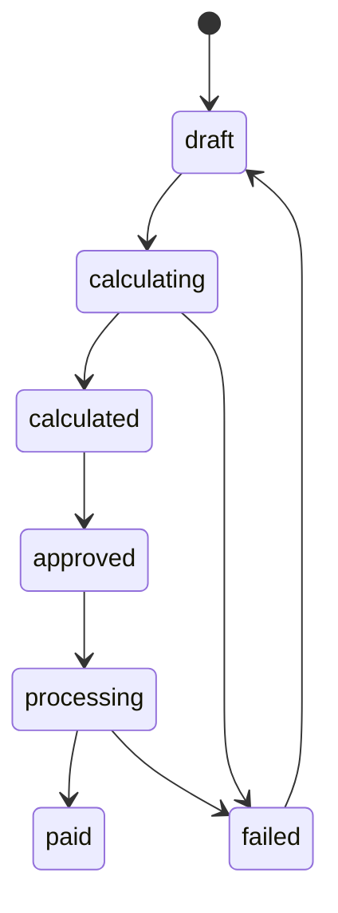

# WorkforceAI — Database Design

## 1. Design Principles

- **ACID compliance** for all financial data (payroll, payments)
- **Soft deletes** for all entities (`is_active` flag, `deleted_at` timestamp)
- **Audit trail** on all mutations (`created_at`, `updated_at`, `created_by`, `updated_by`)
- **UUID primary keys** for all tables (prevents enumeration attacks)
- **Normalized schema** with strategic denormalization only for read-heavy analytics
- **Enum columns** stored as PostgreSQL ENUMs or as `varchar` with `CHECK` constraints
- **Timezone-aware timestamps** stored as `TIMESTAMPTZ` (UTC internally)

---

## 2. Entity Relationship Diagram



---

## 3. Table Definitions

### 3.1 `companies`

> [!NOTE]
> Supports future multi-tenancy. All tenant-scoped entities reference `company_id`.

| Column | Type | Constraints | Description |
|--------|------|-------------|-------------|
| `id` | `UUID` | PK, `DEFAULT gen_random_uuid()` | Primary key |
| `name` | `VARCHAR(255)` | `NOT NULL` | Company name |
| `slug` | `VARCHAR(100)` | `UNIQUE`, `NOT NULL` | URL-safe identifier |
| `settings` | `JSONB` | `DEFAULT '{}'` | Company-specific configuration |
| `is_active` | `BOOLEAN` | `DEFAULT TRUE` | Soft delete flag |
| `created_at` | `TIMESTAMPTZ` | `DEFAULT NOW()` | Record creation time |
| `updated_at` | `TIMESTAMPTZ` | `DEFAULT NOW()` | Last update time |

**Indexes:** `UNIQUE(slug)`

---

### 3.2 `users`

Authentication and authorization.

| Column | Type | Constraints | Description |
|--------|------|-------------|-------------|
| `id` | `UUID` | PK | Primary key |
| `email` | `VARCHAR(255)` | `UNIQUE`, `NOT NULL` | Login email |
| `password_hash` | `VARCHAR(255)` | `NOT NULL` | Bcrypt hash |
| `role` | `VARCHAR(20)` | `NOT NULL`, `CHECK(role IN ('admin', 'hr', 'employee', 'manager'))` | System role |
| `company_id` | `UUID` | FK → `companies(id)`, `NOT NULL` | Company association |
| `is_active` | `BOOLEAN` | `DEFAULT TRUE` | Account status |
| `last_login_at` | `TIMESTAMPTZ` | | Last successful login |
| `created_at` | `TIMESTAMPTZ` | `DEFAULT NOW()` | |
| `updated_at` | `TIMESTAMPTZ` | `DEFAULT NOW()` | |

**Indexes:** `UNIQUE(email)`, `INDEX(company_id)`, `INDEX(role)`

---

### 3.3 `employees`

Extended employee profile linked to user account.

| Column | Type | Constraints | Description |
|--------|------|-------------|-------------|
| `id` | `UUID` | PK | Primary key |
| `user_id` | `UUID` | FK → `users(id)`, `UNIQUE`, `NOT NULL` | Linked user account |
| `company_id` | `UUID` | FK → `companies(id)`, `NOT NULL` | Company |
| `employee_code` | `VARCHAR(50)` | `NOT NULL` | Employee ID code |
| `first_name` | `VARCHAR(100)` | `NOT NULL` | |
| `last_name` | `VARCHAR(100)` | `NOT NULL` | |
| `email` | `VARCHAR(255)` | `NOT NULL` | Work email |
| `phone` | `VARCHAR(20)` | | Phone number |
| `department_id` | `UUID` | FK → `departments(id)` | Department |
| `designation` | `VARCHAR(100)` | | Job title |
| `reporting_manager_id` | `UUID` | FK → `employees(id)` | Direct manager |
| `date_of_joining` | `DATE` | `NOT NULL` | Join date |
| `date_of_exit` | `DATE` | | Exit date |
| `employment_type` | `VARCHAR(20)` | `CHECK(IN ('full_time', 'part_time', 'contract', 'intern'))` | |
| `salary_basic` | `DECIMAL(12,2)` | `NOT NULL` | Basic monthly salary |
| `salary_allowances` | `JSONB` | `DEFAULT '{}'` | Allowance breakdown |
| `bank_account_info` | `JSONB` | `DEFAULT '{}'` | Encrypted bank details |
| `paypal_email` | `VARCHAR(255)` | | PayPal payout email |
| `is_active` | `BOOLEAN` | `DEFAULT TRUE` | Employment status |
| `created_at` | `TIMESTAMPTZ` | `DEFAULT NOW()` | |
| `updated_at` | `TIMESTAMPTZ` | `DEFAULT NOW()` | |

**Indexes:** `UNIQUE(company_id, employee_code)`, `INDEX(department_id)`, `INDEX(reporting_manager_id)`, `INDEX(user_id)`

---

### 3.4 `departments`

| Column | Type | Constraints | Description |
|--------|------|-------------|-------------|
| `id` | `UUID` | PK | Primary key |
| `company_id` | `UUID` | FK → `companies(id)`, `NOT NULL` | Company |
| `name` | `VARCHAR(100)` | `NOT NULL` | Department name |
| `head_id` | `UUID` | FK → `employees(id)` | Department head |
| `is_active` | `BOOLEAN` | `DEFAULT TRUE` | |
| `created_at` | `TIMESTAMPTZ` | `DEFAULT NOW()` | |
| `updated_at` | `TIMESTAMPTZ` | `DEFAULT NOW()` | |

**Indexes:** `UNIQUE(company_id, name)`

---

### 3.5 `leave_policies`

Configurable leave rules per company.

| Column | Type | Constraints | Description |
|--------|------|-------------|-------------|
| `id` | `UUID` | PK | Primary key |
| `company_id` | `UUID` | FK → `companies(id)`, `NOT NULL` | Company |
| `name` | `VARCHAR(100)` | `NOT NULL` | Policy name (e.g., "Casual Leave") |
| `leave_type` | `VARCHAR(30)` | `NOT NULL`, `CHECK(IN ('casual', 'sick', 'annual', 'maternity', 'paternity', 'compensatory', 'unpaid'))` | Leave category |
| `days_allowed` | `INTEGER` | `NOT NULL` | Annual allocation |
| `carry_forward` | `BOOLEAN` | `DEFAULT FALSE` | Can carry to next year |
| `max_carry_forward_days` | `INTEGER` | `DEFAULT 0` | Max carry forward |
| `requires_document` | `BOOLEAN` | `DEFAULT FALSE` | Requires supporting doc |
| `min_days_notice` | `INTEGER` | `DEFAULT 0` | Advance notice days |
| `max_consecutive_days` | `INTEGER` | | Max consecutive days |
| `applicable_after_months` | `INTEGER` | `DEFAULT 0` | Months after joining |
| `is_paid` | `BOOLEAN` | `DEFAULT TRUE` | Paid or unpaid |
| `approval_required` | `BOOLEAN` | `DEFAULT TRUE` | Needs HR approval |
| `policy_document_ref` | `TEXT` | | Reference to policy doc section |
| `is_active` | `BOOLEAN` | `DEFAULT TRUE` | |
| `created_at` | `TIMESTAMPTZ` | `DEFAULT NOW()` | |
| `updated_at` | `TIMESTAMPTZ` | `DEFAULT NOW()` | |

**Indexes:** `UNIQUE(company_id, leave_type, name)`, `INDEX(company_id)`

---

### 3.6 `leave_balances`

Current leave balance per employee per leave type.

| Column | Type | Constraints | Description |
|--------|------|-------------|-------------|
| `id` | `UUID` | PK | Primary key |
| `employee_id` | `UUID` | FK → `employees(id)`, `NOT NULL` | Employee |
| `leave_policy_id` | `UUID` | FK → `leave_policies(id)`, `NOT NULL` | Policy reference |
| `year` | `INTEGER` | `NOT NULL` | Calendar year |
| `total_allocated` | `DECIMAL(5,1)` | `NOT NULL` | Total days allocated |
| `used` | `DECIMAL(5,1)` | `DEFAULT 0` | Days used |
| `pending` | `DECIMAL(5,1)` | `DEFAULT 0` | Days in pending requests |
| `carried_forward` | `DECIMAL(5,1)` | `DEFAULT 0` | Days carried from previous year |
| `created_at` | `TIMESTAMPTZ` | `DEFAULT NOW()` | |
| `updated_at` | `TIMESTAMPTZ` | `DEFAULT NOW()` | |

**Indexes:** `UNIQUE(employee_id, leave_policy_id, year)`, `INDEX(employee_id)`

> [!TIP]
> Available balance is computed as: `available = total_allocated + carried_forward - used - pending`

---

### 3.7 `leave_requests`

| Column | Type | Constraints | Description |
|--------|------|-------------|-------------|
| `id` | `UUID` | PK | Primary key |
| `request_number` | `VARCHAR(20)` | `UNIQUE`, `NOT NULL` | Human-readable ID (e.g., `LR-2026-0042`) |
| `employee_id` | `UUID` | FK → `employees(id)`, `NOT NULL` | Requester |
| `leave_policy_id` | `UUID` | FK → `leave_policies(id)`, `NOT NULL` | Leave type |
| `start_date` | `DATE` | `NOT NULL` | Leave start |
| `end_date` | `DATE` | `NOT NULL` | Leave end |
| `total_days` | `DECIMAL(5,1)` | `NOT NULL` | Total leave days (excludes weekends/holidays) |
| `reason` | `TEXT` | | Employee's reason |
| `status` | `VARCHAR(20)` | `NOT NULL`, `DEFAULT 'pending'`, `CHECK(IN ('draft', 'pending', 'approved', 'rejected', 'cancelled', 'info_requested'))` | Request status |
| `is_paid` | `BOOLEAN` | `NOT NULL` | Paid or unpaid |
| `source_channel` | `VARCHAR(20)` | `NOT NULL`, `CHECK(IN ('app', 'email', 'slack', 'whatsapp'))` | Where request originated |
| `ai_recommendation` | `JSONB` | | AI agent's recommendation |
| `ai_confidence_score` | `DECIMAL(3,2)` | | AI confidence (0.00–1.00) |
| `ai_policy_references` | `JSONB` | | Policy sections AI referenced |
| `reviewed_by` | `UUID` | FK → `users(id)` | HR reviewer |
| `reviewed_at` | `TIMESTAMPTZ` | | Review timestamp |
| `review_comment` | `TEXT` | | HR's comment |
| `created_at` | `TIMESTAMPTZ` | `DEFAULT NOW()` | |
| `updated_at` | `TIMESTAMPTZ` | `DEFAULT NOW()` | |

**Indexes:** `UNIQUE(request_number)`, `INDEX(employee_id)`, `INDEX(status)`, `INDEX(leave_policy_id)`, `INDEX(reviewed_by)`, `INDEX(created_at DESC)`

---

### 3.8 `communication_events`

Tracks all inbound/outbound messages across channels.

| Column | Type | Constraints | Description |
|--------|------|-------------|-------------|
| `id` | `UUID` | PK | Primary key |
| `channel` | `VARCHAR(20)` | `NOT NULL`, `CHECK(IN ('app', 'email', 'slack', 'whatsapp'))` | Communication channel |
| `direction` | `VARCHAR(10)` | `NOT NULL`, `CHECK(IN ('inbound', 'outbound'))` | Message direction |
| `employee_id` | `UUID` | FK → `employees(id)` | Identified employee |
| `leave_request_id` | `UUID` | FK → `leave_requests(id)` | Linked request |
| `external_message_id` | `VARCHAR(255)` | | Gmail/Slack/WhatsApp message ID |
| `sender_identifier` | `VARCHAR(255)` | `NOT NULL` | Email address, Slack user ID, phone |
| `subject` | `VARCHAR(500)` | | Email subject or message title |
| `body` | `TEXT` | | Message content |
| `raw_payload` | `JSONB` | | Full raw message data |
| `ai_extracted_data` | `JSONB` | | AI's extraction results |
| `processing_status` | `VARCHAR(20)` | `DEFAULT 'received'`, `CHECK(IN ('received', 'processing', 'processed', 'failed', 'ignored'))` | |
| `error_message` | `TEXT` | | Processing error details |
| `created_at` | `TIMESTAMPTZ` | `DEFAULT NOW()` | |

**Indexes:** `INDEX(employee_id)`, `INDEX(leave_request_id)`, `INDEX(channel)`, `INDEX(processing_status)`, `INDEX(external_message_id)`

---

### 3.9 `approvals`

Approval chain history for each request.

| Column | Type | Constraints | Description |
|--------|------|-------------|-------------|
| `id` | `UUID` | PK | Primary key |
| `leave_request_id` | `UUID` | FK → `leave_requests(id)`, `NOT NULL` | Request |
| `approver_id` | `UUID` | FK → `users(id)`, `NOT NULL` | Who took action |
| `action` | `VARCHAR(20)` | `NOT NULL`, `CHECK(IN ('approved', 'rejected', 'info_requested', 'escalated', 'comment'))` | Action taken |
| `comment` | `TEXT` | | Approver's note |
| `sequence_order` | `INTEGER` | `NOT NULL` | Approval chain position |
| `created_at` | `TIMESTAMPTZ` | `DEFAULT NOW()` | |

**Indexes:** `INDEX(leave_request_id)`, `INDEX(approver_id)`

---

### 3.10 `documents`

Employee-uploaded documents.

| Column | Type | Constraints | Description |
|--------|------|-------------|-------------|
| `id` | `UUID` | PK | Primary key |
| `employee_id` | `UUID` | FK → `employees(id)`, `NOT NULL` | Owner |
| `leave_request_id` | `UUID` | FK → `leave_requests(id)` | Associated request |
| `document_type` | `VARCHAR(30)` | `NOT NULL`, `CHECK(IN ('medical_certificate', 'supporting_doc', 'policy_doc', 'id_proof', 'other'))` | |
| `file_name` | `VARCHAR(255)` | `NOT NULL` | Original filename |
| `file_path` | `VARCHAR(500)` | `NOT NULL` | Storage path |
| `file_size` | `INTEGER` | | Size in bytes |
| `mime_type` | `VARCHAR(100)` | | Content type |
| `is_sensitive` | `BOOLEAN` | `DEFAULT FALSE` | PHI/PII flag |
| `uploaded_at` | `TIMESTAMPTZ` | `DEFAULT NOW()` | |

**Indexes:** `INDEX(employee_id)`, `INDEX(leave_request_id)`, `INDEX(document_type)`

---

### 3.11 `payroll_batches`

Monthly payroll processing batch.

| Column | Type | Constraints | Description |
|--------|------|-------------|-------------|
| `id` | `UUID` | PK | Primary key |
| `company_id` | `UUID` | FK → `companies(id)`, `NOT NULL` | Company |
| `period_year` | `INTEGER` | `NOT NULL` | Year |
| `period_month` | `INTEGER` | `NOT NULL`, `CHECK(1-12)` | Month |
| `status` | `VARCHAR(20)` | `NOT NULL`, `DEFAULT 'draft'`, `CHECK(IN ('draft', 'calculating', 'calculated', 'approved', 'processing', 'paid', 'failed'))` | Batch status |
| `total_gross` | `DECIMAL(14,2)` | | Total gross salary |
| `total_deductions` | `DECIMAL(14,2)` | | Total deductions |
| `total_net` | `DECIMAL(14,2)` | | Total net payable |
| `employee_count` | `INTEGER` | | Number of employees |
| `approved_by` | `UUID` | FK → `users(id)` | Who approved |
| `approved_at` | `TIMESTAMPTZ` | | Approval timestamp |
| `notes` | `TEXT` | | Batch notes |
| `created_at` | `TIMESTAMPTZ` | `DEFAULT NOW()` | |
| `updated_at` | `TIMESTAMPTZ` | `DEFAULT NOW()` | |

**Indexes:** `UNIQUE(company_id, period_year, period_month)`, `INDEX(status)`

---

### 3.12 `payroll_items`

Individual employee payroll line for a batch.

| Column | Type | Constraints | Description |
|--------|------|-------------|-------------|
| `id` | `UUID` | PK | Primary key |
| `batch_id` | `UUID` | FK → `payroll_batches(id)`, `NOT NULL` | Payroll batch |
| `employee_id` | `UUID` | FK → `employees(id)`, `NOT NULL` | Employee |
| `basic_salary` | `DECIMAL(12,2)` | `NOT NULL` | Basic salary |
| `total_allowances` | `DECIMAL(12,2)` | `DEFAULT 0` | Total allowances |
| `allowances_breakdown` | `JSONB` | `DEFAULT '{}'` | Detailed allowance split |
| `gross_salary` | `DECIMAL(12,2)` | `NOT NULL` | Basic + allowances |
| `paid_leave_days` | `DECIMAL(5,1)` | `DEFAULT 0` | Paid leave days taken |
| `unpaid_leave_days` | `DECIMAL(5,1)` | `DEFAULT 0` | Unpaid leave days |
| `unpaid_leave_deduction` | `DECIMAL(12,2)` | `DEFAULT 0` | Deduction for unpaid leave |
| `attendance_days` | `DECIMAL(5,1)` | | Working days attended |
| `attendance_adjustment` | `DECIMAL(12,2)` | `DEFAULT 0` | Attendance-based adjustment |
| `bonus` | `DECIMAL(12,2)` | `DEFAULT 0` | Bonus amount |
| `other_deductions` | `DECIMAL(12,2)` | `DEFAULT 0` | Other deductions |
| `statutory_deductions` | `JSONB` | `DEFAULT '{}'` | Tax, PF, ESI breakdown |
| `total_deductions` | `DECIMAL(12,2)` | `DEFAULT 0` | Sum of all deductions |
| `net_salary` | `DECIMAL(12,2)` | `NOT NULL` | Final payable amount |
| `status` | `VARCHAR(20)` | `DEFAULT 'calculated'`, `CHECK(IN ('calculated', 'approved', 'paid', 'failed'))` | |
| `created_at` | `TIMESTAMPTZ` | `DEFAULT NOW()` | |
| `updated_at` | `TIMESTAMPTZ` | `DEFAULT NOW()` | |

**Indexes:** `UNIQUE(batch_id, employee_id)`, `INDEX(employee_id)`, `INDEX(status)`

---

### 3.13 `payroll_adjustments`

Manual adjustments to payroll items.

| Column | Type | Constraints | Description |
|--------|------|-------------|-------------|
| `id` | `UUID` | PK | Primary key |
| `payroll_item_id` | `UUID` | FK → `payroll_items(id)`, `NOT NULL` | Payroll line item |
| `adjustment_type` | `VARCHAR(30)` | `NOT NULL`, `CHECK(IN ('bonus', 'deduction', 'correction', 'reimbursement', 'arrears'))` | |
| `amount` | `DECIMAL(12,2)` | `NOT NULL` | Positive or negative |
| `reason` | `TEXT` | `NOT NULL` | Justification |
| `adjusted_by` | `UUID` | FK → `users(id)`, `NOT NULL` | Who made adjustment |
| `created_at` | `TIMESTAMPTZ` | `DEFAULT NOW()` | |

**Indexes:** `INDEX(payroll_item_id)`

---

### 3.14 `payments`

Payment transaction records (PayPal and future providers).

| Column | Type | Constraints | Description |
|--------|------|-------------|-------------|
| `id` | `UUID` | PK | Primary key |
| `batch_id` | `UUID` | FK → `payroll_batches(id)`, `NOT NULL` | Payroll batch |
| `employee_id` | `UUID` | FK → `employees(id)`, `NOT NULL` | Recipient |
| `payroll_item_id` | `UUID` | FK → `payroll_items(id)`, `NOT NULL` | Linked payroll item |
| `amount` | `DECIMAL(12,2)` | `NOT NULL` | Payment amount |
| `currency` | `VARCHAR(3)` | `NOT NULL`, `DEFAULT 'USD'` | Currency code |
| `payment_provider` | `VARCHAR(20)` | `NOT NULL`, `CHECK(IN ('paypal', 'razorpay', 'cashfree', 'manual'))` | Provider |
| `provider_batch_id` | `VARCHAR(255)` | | PayPal payout batch ID |
| `provider_item_id` | `VARCHAR(255)` | | PayPal payout item ID |
| `provider_transaction_id` | `VARCHAR(255)` | | Provider's transaction reference |
| `idempotency_key` | `VARCHAR(255)` | `UNIQUE`, `NOT NULL` | Prevents duplicate payments |
| `recipient_identifier` | `VARCHAR(255)` | `NOT NULL` | PayPal email, bank account, etc. |
| `status` | `VARCHAR(20)` | `NOT NULL`, `DEFAULT 'pending'`, `CHECK(IN ('pending', 'processing', 'success', 'failed', 'returned', 'refunded', 'blocked'))` | |
| `failure_reason` | `TEXT` | | Error details |
| `paid_at` | `TIMESTAMPTZ` | | Actual payment timestamp |
| `webhook_data` | `JSONB` | | Raw webhook payload |
| `created_at` | `TIMESTAMPTZ` | `DEFAULT NOW()` | |
| `updated_at` | `TIMESTAMPTZ` | `DEFAULT NOW()` | |

> [!IMPORTANT]
> The `idempotency_key` column is critical for preventing duplicate payments. It must be generated deterministically from `(batch_id, employee_id, payroll_item_id)` and enforced via a `UNIQUE` constraint.

**Indexes:** `UNIQUE(idempotency_key)`, `INDEX(batch_id)`, `INDEX(employee_id)`, `INDEX(status)`, `INDEX(provider_batch_id)`, `INDEX(provider_transaction_id)`

---

### 3.15 `integrations`

External service configuration.

| Column | Type | Constraints | Description |
|--------|------|-------------|-------------|
| `id` | `UUID` | PK | Primary key |
| `company_id` | `UUID` | FK → `companies(id)`, `NOT NULL` | Company |
| `provider` | `VARCHAR(30)` | `NOT NULL`, `CHECK(IN ('gmail', 'slack', 'whatsapp', 'paypal', 'razorpay', 'google_sheets'))` | |
| `config` | `JSONB` | `NOT NULL` | Encrypted configuration |
| `credentials` | `JSONB` | | Encrypted API keys/tokens |
| `status` | `VARCHAR(20)` | `DEFAULT 'inactive'`, `CHECK(IN ('active', 'inactive', 'error', 'expired'))` | |
| `last_sync_at` | `TIMESTAMPTZ` | | Last successful sync |
| `error_message` | `TEXT` | | Last error |
| `created_at` | `TIMESTAMPTZ` | `DEFAULT NOW()` | |
| `updated_at` | `TIMESTAMPTZ` | `DEFAULT NOW()` | |

> [!CAUTION]
> The `credentials` column stores sensitive API keys and tokens. Values **must** be encrypted at the application layer before writing to the database (e.g., using Fernet symmetric encryption). Never store plaintext secrets.

**Indexes:** `UNIQUE(company_id, provider)`, `INDEX(status)`

---

### 3.16 `policy_documents` (for RAG — stretch goal)

| Column | Type | Constraints | Description |
|--------|------|-------------|-------------|
| `id` | `UUID` | PK | Primary key |
| `company_id` | `UUID` | FK → `companies(id)`, `NOT NULL` | Company |
| `title` | `VARCHAR(255)` | `NOT NULL` | Document title |
| `file_path` | `VARCHAR(500)` | `NOT NULL` | Storage path |
| `document_type` | `VARCHAR(20)` | `CHECK(IN ('pdf', 'docx', 'txt'))` | |
| `chunk_count` | `INTEGER` | | Number of text chunks |
| `is_active` | `BOOLEAN` | `DEFAULT TRUE` | |
| `uploaded_by` | `UUID` | FK → `users(id)` | Uploader |
| `created_at` | `TIMESTAMPTZ` | `DEFAULT NOW()` | |

---

### 3.17 `policy_chunks` (pgvector — stretch goal)

| Column | Type | Constraints | Description |
|--------|------|-------------|-------------|
| `id` | `UUID` | PK | Primary key |
| `document_id` | `UUID` | FK → `policy_documents(id)`, `NOT NULL` | Parent document |
| `chunk_index` | `INTEGER` | `NOT NULL` | Position in document |
| `content` | `TEXT` | `NOT NULL` | Text content |
| `embedding` | `VECTOR(768)` | `NOT NULL` | Text embedding (Gemini embedding dimension) |
| `metadata` | `JSONB` | `DEFAULT '{}'` | Section, page number, etc. |
| `created_at` | `TIMESTAMPTZ` | `DEFAULT NOW()` | |

**Indexes:** `IVFFLAT INDEX` on `embedding` for similarity search, `INDEX(document_id)`

---

### 3.18 `audit_logs`

| Column | Type | Constraints | Description |
|--------|------|-------------|-------------|
| `id` | `UUID` | PK | Primary key |
| `user_id` | `UUID` | FK → `users(id)` | Who performed action |
| `action` | `VARCHAR(50)` | `NOT NULL` | Action identifier |
| `entity_type` | `VARCHAR(50)` | `NOT NULL` | Table/entity name |
| `entity_id` | `UUID` | | Affected record |
| `old_values` | `JSONB` | | Previous state |
| `new_values` | `JSONB` | | New state |
| `ip_address` | `VARCHAR(45)` | | Client IP |
| `user_agent` | `VARCHAR(500)` | | Browser/client info |
| `created_at` | `TIMESTAMPTZ` | `DEFAULT NOW()` | |

**Indexes:** `INDEX(user_id)`, `INDEX(entity_type, entity_id)`, `INDEX(action)`, `INDEX(created_at DESC)`

---

## 4. Indexing Strategy

### Primary Indexes

- All primary keys (`UUID`) are automatically indexed
- All foreign keys should have indexes for `JOIN` performance
- All `UNIQUE` constraints create implicit indexes

### Query-Optimized Indexes

| Index | Justification |
|-------|---------------|
| `leave_requests(employee_id, status)` | Employee viewing their requests filtered by status |
| `leave_requests(status, created_at DESC)` | HR dashboard showing pending requests, newest first |
| `payroll_items(employee_id, batch_id)` | Employee payslip lookup |
| `payments(status, created_at)` | Payment reconciliation queries |
| `audit_logs(entity_type, entity_id, created_at DESC)` | Viewing audit trail for specific records |
| `communication_events(channel, processing_status)` | Processing inbound messages by channel |

### Partial Indexes

| Index | Justification |
|-------|---------------|
| `leave_requests WHERE status = 'pending'` | Most queries filter for pending requests |
| `payments WHERE status IN ('pending', 'processing')` | Active payment monitoring |

> [!TIP]
> Partial indexes significantly reduce index size and improve write performance. Use them for columns where the majority of queries target a small subset of values.

---

## 5. Data Integrity Rules

1. **Leave balance cannot go negative** — `CHECK` constraint or application-level validation
2. **Payroll batch status transitions** — Only valid transitions allowed:



3. **Payment idempotency** — `UNIQUE` constraint on `idempotency_key` prevents double payments
4. **Employee code uniqueness** — `UNIQUE` per company via `UNIQUE(company_id, employee_code)`
5. **Leave date validation** — `end_date >= start_date` (`CHECK` constraint)
6. **Salary values** — All monetary fields `DECIMAL(12,2)`, never `FLOAT`
7. **No orphaned records** — Foreign keys with appropriate `ON DELETE` actions:

| Relationship | ON DELETE Action | Rationale |
|--------------|-----------------|-----------|
| `payroll_adjustments → payroll_items` | `CASCADE` | Adjustments are meaningless without their parent item |
| `policy_chunks → policy_documents` | `CASCADE` | Chunks are derived data, safe to cascade |
| `approvals → leave_requests` | `CASCADE` | Approvals are part of the request lifecycle |
| `employees → departments` | `SET NULL` | Employee should survive department deletion |
| `employees → companies` | `RESTRICT` | Cannot delete a company with employees |
| `payments → employees` | `RESTRICT` | Cannot delete employee with payment history |

> [!WARNING]
> Never use `ON DELETE CASCADE` for financial tables (`payments`, `payroll_items`, `payroll_batches`). Use `RESTRICT` to prevent accidental data loss and maintain audit integrity.

---

## 6. Migration Strategy

### Tool

- **Alembic** for version-controlled database migrations
- Each migration should be reversible (`upgrade` + `downgrade`)

### Migration Conventions

```
migrations/
├── versions/
│   ├── 001_create_companies.py
│   ├── 002_create_users.py
│   ├── 003_create_departments.py
│   ├── 004_create_employees.py
│   ├── 005_create_leave_policies.py
│   ├── 006_create_leave_balances.py
│   ├── 007_create_leave_requests.py
│   ├── 008_create_communication_events.py
│   ├── 009_create_approvals.py
│   ├── 010_create_documents.py
│   ├── 011_create_payroll_tables.py
│   ├── 012_create_payments.py
│   ├── 013_create_integrations.py
│   ├── 014_create_audit_logs.py
│   └── 015_create_policy_rag_tables.py
├── env.py
└── alembic.ini
```

### Seed Data

| Entity | Seed Data |
|--------|-----------|
| **Default Company** | "WorkforceAI Demo Corp" with slug `workforceai-demo` |
| **Admin User** | `admin@workforceai.com` with role `admin` |
| **Departments** | Engineering, HR, Finance, Marketing |
| **Leave Policies** | Casual Leave (12d), Sick Leave (10d), Annual Leave (15d), Maternity (180d), Paternity (15d) |

### Test Data Fixtures

Development environment should include:

- 20+ sample employees across departments
- Leave requests in various states (`pending`, `approved`, `rejected`)
- A completed payroll batch with payroll items
- Sample communication events from different channels
- Audit log entries for key actions
