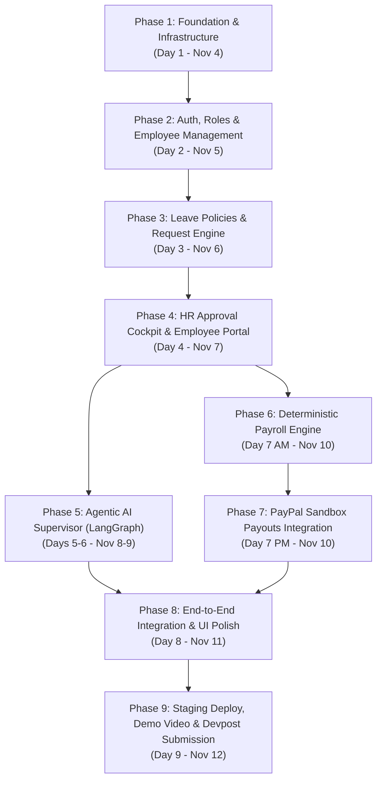

# WorkforceAI – Phased Development Roadmap

## Executive Overview

- **Target Hackathon**: Build What's Next with PayPal and AI (Devpost)
- **Submission Deadline**: November 12, 2026 at 12:00 PM Pacific Time (Nov 13, 1:30 AM IST)
- **Available Working Window**: ~9 Days (Nov 4 – Nov 12, 2026)
- **Primary Objective**: Deliver a stable, highly-polished, end-to-end working proof of concept demonstrating an Agentic AI HR workflow connected to automated PayPal Sandbox salary payouts, backed by a verifiable Git repository and an under-3-minute demo video.

---

## 1. Roadmap Dependency Graph

---

## 2. Phase-by-Phase Detailed Specifications

### Phase 1: Foundation, Tooling & Infrastructure (Day 1 – Nov 4)

#### Objectives
Establish an automated, containerized local and cloud development environment with database migrations and code styling standards.

#### Features
- Multi-container Docker Compose configuration (`api`, `frontend`, `db` with `pgvector`, `redis`).
- FastAPI application scaffolding with modular routing, CORS, and Pydantic v2 settings.
- Vite + React + TypeScript + Tailwind CSS + shadcn/ui base structure.
- Database connection lifecycle management and Alembic schema migration runner.
- Health check endpoints (`/api/v1/health`) validating DB and Redis connectivity.

#### Components
- `docker-compose.yml`
- `backend/app/main.py`, `backend/app/config.py`, `backend/app/database.py`
- `backend/alembic/` (Initial base tables migration)
- `frontend/src/App.tsx`, `frontend/vite.config.ts`, `frontend/tailwind.config.js`

#### Dependencies
- Local Docker Desktop, Python 3.12, Node.js 20+.

#### Deliverables & Acceptance Criteria
- [ ] Running `docker compose up` starts all 4 containers cleanly without errors.
- [ ] `GET http://localhost:8000/api/v1/health` returns `{"status": "healthy", "database": "connected", "redis": "connected"}`.
- [ ] Frontend displays on `http://localhost:3000` with hot module replacement active.
- [ ] Git repository initialized with an OSI MIT `LICENSE` and comprehensive `.gitignore`.

#### Testing Requirements
- Pytest suite verifies DB connection and async session lifecycle.

#### Estimated Complexity: Low-Medium

---

### Phase 2: Authentication, RBAC & Employee Management (Day 2 – Nov 5)

#### Objectives
Implement secure authentication, role-based route guards, employee roster management, and bulk CSV ingestion.

#### Features
- JWT authentication: login, token issuance, refresh tokens, and password hashing with Bcrypt.
- Role-based authorization middleware enforcing access for `admin`, `hr`, `manager`, and `employee`.
- Employee profile CRUD operations (personal details, designation, department, basic salary, allowances).
- Department management (creation, listing, manager assignment).
- Bulk CSV/Excel employee upload with schema validation and duplicate detection (checking employee code and email).

#### Components
- `backend/app/modules/auth/` (routes, service, JWT utils, schemas)
- `backend/app/modules/employees/` (router, CRUD service, import parser)
- `backend/app/modules/departments/` (router, service)
- `frontend/src/pages/auth/Login.tsx`
- `frontend/src/pages/hr/EmployeeRoster.tsx`
- `frontend/src/components/employees/CSVImportModal.tsx`

#### Dependencies
- Phase 1 complete.

#### Deliverables & Acceptance Criteria
- [ ] Users can sign in and receive JWTs; invalid credentials are rejected with HTTP 401.
- [ ] Protected endpoints reject unauthenticated or under-privileged requests (e.g., employee accessing HR salary endpoints returns HTTP 403).
- [ ] HR can view, add, edit, and deactivate employee profiles.
- [ ] Uploading a CSV with 20 employees parses valid rows and flags duplicate or invalid rows with precise line errors.

#### Testing Requirements
- Pytest: Auth login, refresh, expired tokens, role permission fixtures.
- Pytest: CSV parser test with valid, malformed, and duplicate datasets.

#### Estimated Complexity: Medium

---

### Phase 3: Leave Policies & Request Engine (Day 3 – Nov 6)

#### Objectives
Build the structured policy engine and employee leave application lifecycle with strict balance validation.

#### Features
- Leave policy configuration (policy name, leave type, annual allocation, carryover rules, paid vs unpaid).
- Automatic employee leave balance initialization (allocated, used, pending, carried forward).
- Employee leave application submission with automated business rule validation:
  - Date validation (`end_date >= start_date`, excluding holidays/weekends).
  - Balance sufficiency check (`available >= requested_days`).
  - Overlap prevention (rejects overlapping pending/approved dates).
- Dynamic calculation of working days within the requested range.

#### Components
- `backend/app/modules/leave/` (routers, leave request service, balance calculator)
- `backend/app/modules/policies/` (policy configuration router & models)
- `frontend/src/pages/employee/ApplyLeaveModal.tsx`
- `frontend/src/pages/employee/LeaveHistory.tsx`
- `frontend/src/pages/hr/PolicySettings.tsx`

#### Dependencies
- Phase 2 complete.

#### Deliverables & Acceptance Criteria
- [ ] HR can configure company leave categories (Casual, Sick, Annual, Unpaid).
- [ ] Employees can apply for leave; requesting more days than available balance triggers an actionable warning or defaults to unpaid leave.
- [ ] Submitting overlapping requests returns HTTP 409 Conflict with details of the conflicting request.
- [ ] Leave balance reflects pending days immediately upon submission.

#### Testing Requirements
- Pytest: Balance deduction logic, date conflict checker, weekend exclusion formulas.

#### Estimated Complexity: Medium

---

### Phase 4: HR Approval Cockpit & Employee Self-Service (Day 4 – Nov 7)

#### Objectives
Deliver the unified HR approval queue with optimistic locking and complete the employee self-service experience.

#### Features
- HR Request Queue displaying all pending leave submissions across the organization.
- Human actions: Approve, Reject, or Request Clarification with audit comments.
- Automatic balance transition upon decision:
  - Approved: `pending` decreases, `used` increases.
  - Rejected: `pending` decreases back to `available`.
- Optimistic locking preventing simultaneous conflicting approvals on the same record.
- In-app notification bell and WebSocket event pushes for real-time status updates.
- Employee portal dashboard displaying remaining leave cards, recent requests, and profile details.

#### Components
- `backend/app/modules/leave/approval_service.py`
- `backend/app/modules/notifications/` (in-app notification service & WebSocket router)
- `frontend/src/pages/hr/ApprovalQueue.tsx`
- `frontend/src/pages/employee/Dashboard.tsx`
- `frontend/src/components/layout/NotificationDrawer.tsx`

#### Dependencies
- Phase 3 complete.

#### Deliverables & Acceptance Criteria
- [ ] HR can approve or reject requests with one click.
- [ ] Balances accurately update in PostgreSQL with transactional guarantees (`BEGIN ... COMMIT`).
- [ ] Employee receives immediate in-app notification when their request is resolved.
- [ ] Two concurrent HR approvals on the same request resolve safely without race conditions.

#### Testing Requirements
- Pytest: Approval transition state machine, concurrent update simulation tests.

#### Estimated Complexity: Medium-High

---

### Phase 5: Agentic AI Supervisor & LangGraph Workflow (Days 5–6 – Nov 8–9)

#### Objectives
Integrate the LangGraph supervisor workflow and Gemini 2.5 Flash to parse natural language requests, evaluate policies, and generate transparent recommendations.

#### Features
- **LangGraph Supervisor Graph**:
  - `ParserNode`: Extracts dates, leave type, and reason from natural language text into a strict Pydantic model.
  - `BalanceCheckTool`: Evaluates employee balances via SQL query.
  - `PolicyEvalTool`: Evaluates policy eligibility, tenure requirements, and handbook clauses.
  - `RecommendationNode`: Generates a structured recommendation payload with confidence score, reasoning, policy citation, and projected salary impact.
- **Human-in-the-Loop (HITL) Checkpoint**:
  - Pauses graph execution at approval gates; resumes seamlessly when HR approves or rejects in the UI.
- **Embedded Web Chat Widget**:
  - Allows employees to converse with the HR AI Assistant to query policies, check balances, or submit leave requests in plain language.
- **AI Recommendation Card in HR Cockpit**:
  - Displays recommendation badge (`APPROVE`, `REJECT`, `NEEDS_REVIEW`), confidence percentage, and clickable policy references.

#### Components
- `backend/app/modules/agents/` (graph definitions, node functions, tools, state schema)
- `backend/app/modules/agents/llm_client.py` (Gemini 2.5 Flash client with fallback configuration)
- `frontend/src/components/chat/HRAssistantWidget.tsx`
- `frontend/src/components/hr/AIRecommendationBadge.tsx`

#### Dependencies
- Phase 4 complete; Google Gemini API key configured.

#### Deliverables & Acceptance Criteria
- [ ] Typing *"I need 2 days off next Thursday and Friday for personal reasons"* extracts start date, end date, and reason with 100% schema compliance.
- [ ] AI cites the exact policy rule (e.g., *"Eligible for Casual Leave under Rule 4.1; 0 days unpaid deduction"*).
- [ ] Request automatically appears in HR's approval queue with the AI badge and confidence score.
- [ ] AI never auto-approves requests directly into the database without human consent.

#### Fallback Strategy
If LangGraph state persistence introduces setup delays on Day 5, fall back to a direct procedural Python agent loop using Gemini function calling and Pydantic validation, saving the state directly in PostgreSQL.

#### Estimated Complexity: HIGH

---

### Phase 6: Deterministic Payroll Engine (Day 7 AM – Nov 10)

#### Objectives
Implement the 100% deterministic payroll calculation engine that reconciles approved leave with salary calculations.

#### Features
- Monthly payroll batch creation (e.g., November 2026).
- Deterministic per-employee calculation:
  - Gross salary = Base salary + Fixed allowances.
  - Approved unpaid leave days = Counted from `leave_requests`.
  - Unpaid leave deduction = `(Base Salary / Total Period Working Days) * Unpaid Days`.
  - Statutory deductions (configured percentages for TDS/tax, PF, insurance).
  - Final net payable calculation using Python `Decimal` (zero floating-point math).
- Anomaly flagging (flags zero or negative net pay, unusual overtime, or duplicate entries).
- HR payroll summary dashboard with line-item drilldown and manual adjustment capabilities.

#### Components
- `backend/app/modules/payroll/` (calculation service, batch manager, payslip generator)
- `frontend/src/pages/hr/PayrollRun.tsx`
- `frontend/src/pages/hr/PayrollBatchDetail.tsx`
- `frontend/src/pages/employee/PayslipView.tsx`

#### Dependencies
- Phase 4 complete (requires approved leave data).

#### Deliverables & Acceptance Criteria
- [ ] Triggering payroll for a test month computes accurate gross, deductions, and net figures for all employees.
- [ ] An employee with 2 approved unpaid leave days has their salary deducted exactly by `(Base / 22) * 2`.
- [ ] An employee with approved paid leave incurs zero salary deduction.
- [ ] Employee can view their calculated payslip with itemized deductions in their portal.

#### Testing Requirements
- Pytest: Comprehensive parameterized unit tests covering 10+ edge cases (unpaid leaves, mid-month joining, zero allowances, manual bonuses) with exact penny-level assertions.

#### Estimated Complexity: Medium-High

---

### Phase 7: PayPal Sandbox Payouts Integration (Day 7 PM – Nov 10)

#### Objectives
Integrate the PayPal Developer Platform to disburse batch salary payments via PayPal Sandbox Payouts API with full idempotency and webhook tracking.

#### Features
- **PayPal OAuth 2.0 Integration**: Automatic client credential token retrieval and caching in Redis.
- **Batch Payout Execution**:
  - Maps approved payroll items into a PayPal Payout request payload (`POST /v1/payments/payouts`).
  - Sets unique `sender_batch_id` and per-item `sender_item_id` (idempotency keys).
- **Payment Lifecycle Tracking**:
  - Updates payment status: `PENDING` -> `PROCESSING` -> `SUCCESS` / `FAILED`.
  - Records PayPal transaction IDs and fee breakdowns in PostgreSQL.
- **Webhook Processing**:
  - Ingestion endpoint for PayPal webhook events (`PAYMENT.PAYOUTS-ITEM.SUCCEEDED`, etc.).
  - Webhook signature cryptographic verification via PayPal API.
- **Abstract Provider Architecture**: Shows clean separation between the PayPal Sandbox implementation and future Indian domestic payout rails.

#### Components
- `backend/app/modules/payments/paypal_adapter.py`
- `backend/app/modules/payments/provider_interface.py`
- `backend/app/modules/payments/webhook_service.py`
- `frontend/src/components/hr/ExecutePayoutModal.tsx`
- `frontend/src/pages/hr/PaymentReconciliation.tsx`

#### Dependencies
- Phase 6 complete; PayPal Sandbox Developer credentials (`CLIENT_ID`, `CLIENT_SECRET`).

#### Deliverables & Acceptance Criteria
- [ ] Clicking "Authorize & Disburse Payout" in the HR console creates a live payout batch in PayPal Sandbox.
- [ ] The PayPal Developer Sandbox Dashboard reflects the real transaction batch, item IDs, and transferred amounts.
- [ ] Webhook or status polling updates local database payment records to `SUCCESS`.
- [ ] Retrying a failed or in-flight payout is blocked by the idempotency key, preventing duplicate payouts.

#### Testing Requirements
- Pytest: PayPal OAuth mock tests, payout payload generation tests, idempotency collision tests.

#### Estimated Complexity: Medium-High

---

### Phase 8: End-to-End Integration, Staging Deploy & UI Polish (Day 8 – Nov 11)

#### Objectives
Unify all modules into a frictionless end-to-end user journey, deploy a live staging demo, and execute thorough bug squashing.

#### Features
- Seamless end-to-end walkthrough:
  1. Employee submits leave via natural language chat.
  2. AI agent structures request, checks policy, and generates recommendation card.
  3. HR reviews recommendation in Approval Queue and clicks 'Approve'.
  4. Leave balance and employee notification update immediately.
  5. HR navigates to Payroll, generates batch, and verifies deduction calculation.
  6. HR executes payout via PayPal Sandbox, and transaction completes.
  7. Employee views updated payslip and payment receipt in their portal.
- Cloud staging deployment on Render or Railway for public testing.
- UI polish: Responsive styling, loading spinners, toast alerts, error boundaries, and empty states.
- Pre-seeded realistic demo data script (`seed_data.py`) creating departments, employees, historical leaves, and policy handbook.

#### Components
- `backend/scripts/seed_data.py`
- Staging Docker configuration or Render/Railway blueprints.
- Frontend UI components (`Toast`, `SkeletonLoader`, `ErrorBoundary`).

#### Dependencies
- Phases 1 through 7 complete.

#### Deliverables & Acceptance Criteria
- [ ] Complete end-to-end workflow runs smoothly without a single console error or backend exception.
- [ ] Hosted staging environment accessible via public URL with HTTPS.
- [ ] Running `python scripts/seed_data.py` creates a complete, realistic demo state in under 10 seconds.
- [ ] Code freeze enacted at 6:00 PM on Day 8.

#### Estimated Complexity: Medium

---

### Phase 9: Demo Video Production & Devpost Submission (Day 9 – Nov 12)

#### Objectives
Record and edit the 3-minute video, assemble comprehensive Devpost documentation, verify open-source requirements, and submit well before the deadline.

#### Deliverables & Tasks
- [ ] **Demo Video Recording**:
  - Follow the exact 2m 50s script defined in `HACKATHON_STRATEGY.md`.
  - Record high-resolution screen capture (1080p, 60fps) with clear microphone audio.
  - Show the live PayPal Sandbox dashboard confirming transaction execution.
  - Upload to YouTube as Public / Unlisted and verify playback on mobile and desktop.
- [ ] **Repository Verification**:
  - Ensure public GitHub visibility.
  - Verify `LICENSE` (MIT) is present in the root.
  - Ensure `README.md` includes:
    - Project description & architecture diagrams.
    - Quickstart guide (`docker compose up`).
    - API documentation link.
    - Video link and Devpost submission link.
  - Confirm no credentials or `.env` secrets are committed.
- [ ] **Devpost Submission Submission**:
  - Fill out all required fields on Devpost.
  - Submit by **6:00 AM IST on Nov 12** (well ahead of the 1:30 AM IST Nov 13 hard deadline).

#### Estimated Complexity: Low technical, High strategic priority

---

## 3. Risk Mitigation Checkpoints

| Checkpoint | Target Date | Success Metric | Contingency Action if Blocked |
|---|---|---|---|
| **Checkpoint 1** | End of Day 2 (Nov 5) | Multi-role auth & employee roster operational. | Simplify auth to predefined mock JWT fixtures to keep moving. |
| **Checkpoint 2** | End of Day 4 (Nov 7) | Manual leave application & HR approval cycle working. | Defer Slack/Gmail integrations; keep focus exclusively on in-app portal. |
| **Checkpoint 3** | End of Day 6 (Nov 9) | LangGraph AI agent extracting and recommending. | Fall back to procedural Python Gemini function-calling script. |
| **Checkpoint 4** | End of Day 7 (Nov 10) | PayPal Sandbox payout executing via API. | Use PayPal Payouts mock sandbox fallback mode with pre-recorded sandbox B-roll. |
| **Checkpoint 5** | End of Day 8 (Nov 11) | Code frozen; end-to-end demo running on local & staging. | Cut all remaining non-essential features; focus 100% on demo video recording. |

---

## 4. Post-Hackathon Roadmap (Commercialization)

| Feature | Description | Target Window |
|---|---|---|
| **Domestic Indian Payouts** | Plug in RazorpayX or Cashfree Payouts API for direct NEFT/IMPS/UPI salary transfers. | Month 1 Post-Hackathon |
| **WhatsApp Business API** | Connect Meta WhatsApp Cloud API for conversational leave requests via mobile. | Month 1 Post-Hackathon |
| **Google Sheets Bi-directional Sync** | Two-way automated sync between Google Sheets rosters and WorkforceAI. | Month 2 Post-Hackathon |
| **Advanced Multi-Tier Approvals** | Dynamic approval routing (e.g., Manager -> HR -> Finance) based on department rules. | Month 2 Post-Hackathon |
| **Full PDF Payslips with Digital Signatures** | Automated PDF generation, password encryption, and automated email dispatch. | Month 3 Post-Hackathon |
| **Multi-Company Tenancy** | White-labeling and multi-tenant database partitioning for HR consulting firms. | Month 4 Post-Hackathon |
