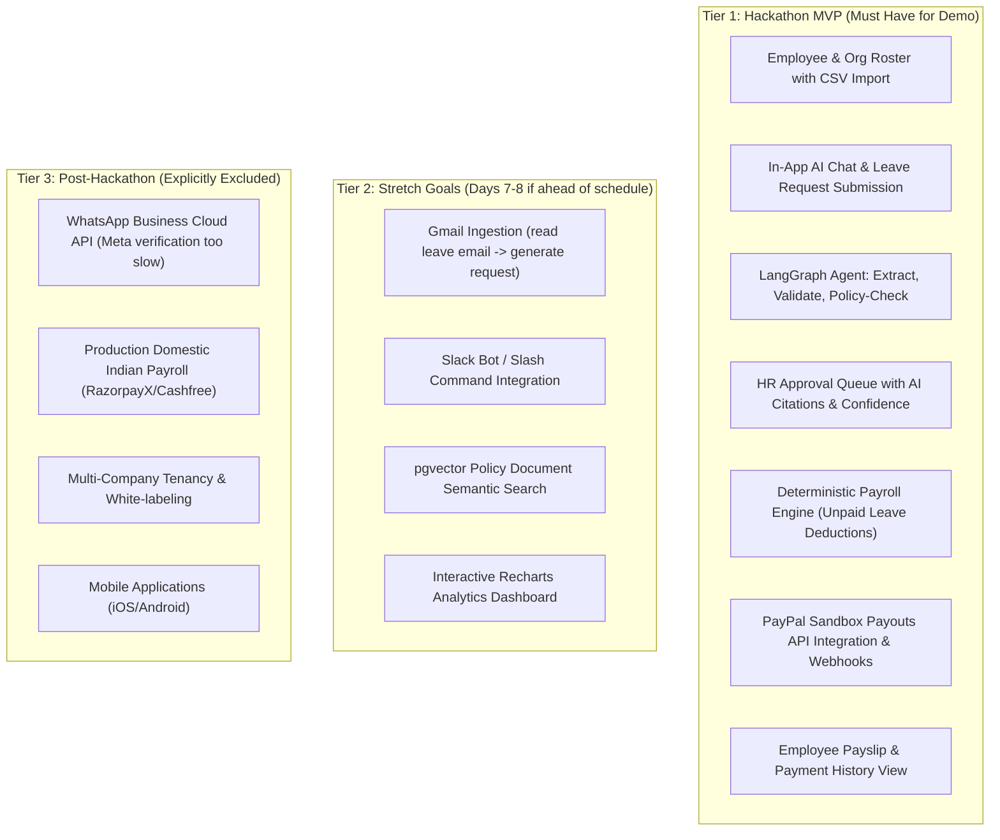

# WorkforceAI – Hackathon Strategy & Execution Plan

## 1. Hackathon Overview & Constraints

| Parameter | Official Details |
|---|---|
| **Hackathon Name** | **Build What's Next with PayPal and AI** |
| **Host Platform** | Devpost |
| **Submission Deadline** | **November 12, 2026 at 12:00 PM Pacific Time** (Nov 13, 2026 at 1:30 AM IST) |
| **Judging Period** | December 1 – December 15, 2026 |
| **Winners Announced** | December 21, 2026 |
| **Time Remaining** | **~9 Days** (from Nov 3, 2026) |
| **Total Prize Pool** | **~$67,500 – $70,000** |
| **Target Categories** | 🥇 1st Place ($12,000)<br/>🏆 Best Use of PayPal + AI ($5,000)<br/>🏆 Best Use of Agentic Commerce ($5,000)<br/>🏆 Best Demo Delivery ($5,000) |

---

## 2. Core Hackathon Mandate: The Golden Rule

Devpost rules state unequivocally: **Projects must meaningfully integrate BOTH PayPal AND AI. Superficial integrations, mockups, or standalone wrappers are disqualified.**

### How WorkforceAI Meets the PayPal Requirement
- **Deep REST Integration**: Uses PayPal Payouts API (`/v1/payments/payouts`) with OAuth 2.0 client credential flows, dynamic batch generation, and transaction status polling.
- **Asynchronous Webhooks**: Listens for `PAYMENT.PAYOUTS-ITEM.SUCCEEDED` and `PAYMENT.PAYOUTS-ITEM.FAILED` events and verifies cryptographic webhook signatures using `/v1/notifications/verify-webhook-signature`.
- **Enterprise-Grade Idempotency**: Transmits `PayPal-Request-Id` headers and stores unique idempotency hashes to guarantee zero double-disbursements.
- **Agentic Commerce Tie-In**: Enables an AI agent to prepare the payment batch payload, assess financial adjustments, and present an actionable authorization card directly to the human approver.

### How WorkforceAI Meets the AI Requirement
- **Agentic Multi-Step Workflow**: Not a basic chatbot. An intelligent supervisor agent built with LangGraph orchestrates intake, entity extraction, policy evaluation, and recommendation synthesis.
- **Deterministic Schema Enforcement**: Enforces structured JSON output via Pydantic models for dates, reasons, and policy classifications.
- **Policy-Aware Grounding (RAG)**: Indexes company leave and HR policy handbooks into PostgreSQL `pgvector`, retrieving verbatim clauses to substantiate AI decisions.
- **Human-in-the-Loop (HITL) Checkpointing**: Pauses execution state until an authorized human grants permission, proving ethical and safe AI operation.

---

## 3. Four Mandatory Submission Deliverables

| Deliverable | Requirement | Our Production Strategy |
|---|---|---|
| **1. Text Description** | Clear, comprehensive problem statement, architecture overview, feature list, and API breakdown. | Drafted directly from `PROJECT_VISION.md` and `SYSTEM_ARCHITECTURE.md`. Highlights the Agentic HR-to-Payroll pipeline. |
| **2. Working Prototype** | Judges must be able to run or test the live solution. | Provide a reproducible `docker compose up` one-liner with pre-seeded sample data, plus a hosted staging URL (Render/Railway) for instant access. |
| **3. Open-Source Repository** | Public GitHub repo with visible OSI-compliant open-source license. | Clean repository with an MIT License, `.env.example`, architectural diagrams, and strict exclusion of credentials. |
| **4. Demo Video** | Video strictly **under 3 minutes** showing end-to-end functionality. | High-production, crisp, scripted YouTube video demonstrating the complete request-to-payout cycle. |

---

## 4. Judging Criteria & Tactical Alignment

| Judging Pillar (20% Each) | What Judges Look For | How WorkforceAI Maximizes Score |
|---|---|---|
| **Technological Implementation** | Architecture quality, robustness, API depth, clean code. | Production-grade FastAPI + LangGraph + PostgreSQL + pgvector + PayPal Payouts. Strong type hints, Pydantic validation, idempotent payment safeguards. |
| **Innovation** | Novel concept, creative use of AI and fintech APIs. | Bridges the gap between messy unstructured employee communications (email/Slack) and automated payroll disbursements through agentic reasoning. |
| **Potential Impact** | Real-world utility, commercial viability, enterprise pain relief. | Solves a universal business pain: HR teams spend 15+ hours/month reconciling leave, manual deductions, and payroll spreadsheets. |
| **Design & UX** | Polish, responsiveness, intuitiveness, clean dashboard. | Modern UI built with Tailwind CSS and shadcn/ui. Clear visual distinction between Employee Self-Service and HR Operations consoles. |
| **Presentation** | Clarity of video, concise communication, complete docs. | Professional 3-minute video with a narrative arc, clear audio voiceover, and live working PayPal Sandbox confirmations. |

---

## 5. Scope Management: 9-Day Hackathon MVP vs Post-Hackathon

To guarantee completion before the November 12 deadline, scope is segmented into three tiers:



---

## 6. Navigating the PayPal India Domestic Payout Limitation

### The Regulatory Reality
- PayPal operates in India exclusively as a **Cross-Border Payment Aggregator** under RBI FEMA regulations.
- PayPal completely shut down domestic payment processing and domestic P2P wallet transfers in India in April 2021.
- Indian business accounts cannot execute domestic INR payouts to Indian beneficiaries via the live PayPal Payouts API.

### Our Winning Hackathon Strategy
1. **Full Sandbox Demonstration**: PayPal Sandbox environments do not enforce Indian cross-border constraints. We use PayPal Sandbox to demonstrate complete global/cross-border payouts with USD/EUR disbursements.
2. **Abstracted Payment Provider Architecture**: We showcase an enterprise design pattern (`PaymentProvider` base class).
3. **Honest, Professional Positioning**: We state in the submission:
   > *"WorkforceAI leverages PayPal Payouts for global contractor and cross-border team compensation. For domestic Indian payroll, our pluggable payment abstraction seamlessly routes through RBI-compliant domestic rails (RazorpayX / Cashfree), demonstrating production architectural maturity."*
4. **Judges Respect This**: Demonstrating awareness of real-world compliance while fully exercising PayPal's developer APIs wins credibility points over teams who blindly assume Sandbox behavior works globally in production.

---

## 7. Scripted 3-Minute Video Storyline (Winning Demo Script)

**Target Video Duration: 2 minutes 50 seconds (leaves 10s buffer under the 3-minute hard ceiling).**

```mermaid
timeline
    title 3-Minute Demo Narrative Timeline
    00:00 - 00:25 : Problem Hook & Solution Introduction
    00:25 - 01:05 : Employee Experience & Multi-Channel Intake
    01:05 - 01:45 : AI Agent Reasoning & HR Approval Cockpit
    01:45 - 02:25 : Payroll Calculation & Live PayPal Payout
    02:25 - 02:50 : Verification, Architecture & Closing
```

### Detailed Script Breakdown

#### Scene 1: The Hook (0:00 – 0:25)
- **Visual**: Quick montage of messy spreadsheets, overflowing Gmail inboxes, and fragmented Slack messages.
- **Voiceover**:
  > *"Every month, HR teams spend dozens of hours manually chasing leave requests across email and chat, recalculating salary deductions on spreadsheets, and staging manual bank transfers. Meet WorkforceAI – the agentic workforce platform that connects employee requests, company policies, deterministic payroll, and automated PayPal payouts into one unified pipeline."*

#### Scene 2: The Ingestion & AI Reasoning (0:25 – 01:05)
- **Visual**: Screen recording showing an employee typing an unstructured message into the integrated portal (or sending a leave email): *"Hi, I need to take 3 days off next week from Wednesday to Friday for my sister's wedding."*
- **Voiceover**:
  > *"An employee asks for leave in natural language. Immediately, our LangGraph AI Supervisor extracts the exact dates, checks the company's leave policies in PostgreSQL, and verifies remaining leave balances. Notice the AI doesn't just guess – it cites Section 3.2 of the company handbook, calculates that this falls under Paid Casual Leave with zero salary penalty, and stages a pending request."*

#### Scene 3: HR Cockpit & Human-in-the-Loop Approval (01:05 – 01:45)
- **Visual**: Switch to HR Manager Dashboard. A real-time notification pops up in the Approval Queue. The request displays with an AI badge: *"Recommendation: APPROVE (98% confidence). Policy Ref: Casual Leave Clause 3.2. Salary Deduction: $0.00."*
- **Voiceover**:
  > *"Over in the HR cockpit, the manager receives the staged request with full context. Crucially, the AI advises, but the human decides. The HR manager reviews the recommendation, clicks 'Approve', and the employee is instantly notified on their channel."*

#### Scene 4: Deterministic Payroll & Automated PayPal Payout (01:45 – 02:25)
- **Visual**: HR navigates to Payroll Dashboard. Clicks 'Generate Period Batch'. Shows approved leaves automatically reconciled into attendance. Base salary and allowances are calculated. HR clicks 'Authorize & Execute Batch Payout'.
- **Voiceover**:
  > *"At the end of the month, payroll calculation is 100% deterministic – no AI hallucinations with company money. Unpaid leaves trigger exact pro-rata deductions. With one click, the HR executive authorizes the batch payout. WorkforceAI calls the PayPal Payouts API with unique idempotency keys."*
- **Visual**: The UI shows real-time payout status updating from `PROCESSING` to `SUCCESS`. Cut to PayPal Developer Sandbox Dashboard showing the live transaction batch ID, amount, and recipient confirmation.

#### Scene 5: Payslip & Closing (02:25 – 02:50)
- **Visual**: Switch back to Employee Portal showing the newly generated payslip and PayPal payment receipt. Quick pan across the modular architecture diagram.
- **Voiceover**:
  > *"The employee instantly receives their digital payslip and payment confirmation. Built with FastAPI, React, LangGraph, and PayPal Developer Platform, WorkforceAI brings agentic intelligence to enterprise operations. Thank you!"*

---

## 8. Top 10 Hackathon Risks & Mitigation Matrix

| # | Technical / Operational Risk | Probability | Impact | Mitigation Strategy |
|---|---|---|---|---|
| **1** | **LangGraph graph complexity stalls progress** | Medium | High | Use a simplified state graph (Intake → PolicyTool → Recommendation → HITL). If blocked on day 5, fallback to a clean procedural Python service using Gemini API with Pydantic structured output. |
| **2** | **PayPal Sandbox API latency or downtime** | Medium | High | Implement robust asynchronous polling with backoff. For the video recording, execute real API transactions during a verified uptime window and capture clear B-roll. |
| **3** | **OAuth token expiration during demo** | Low | High | Implement automatic OAuth token caching in Redis with proactive refresh 5 minutes before TTL expires. |
| **4** | **Payment double-submission during retries** | Low | Critical | Generate deterministic UUIDs derived from `batch_id + employee_id` as the `idempotency_key` and PayPal `sender_batch_id`. |
| **5** | **LLM prompt injection or hallucinations** | Medium | Medium | Strict Pydantic JSON schemas on all model outputs. Strip markdown formatting and enforce field range bounds. |
| **6** | **Scope creep in external channel setup** | High | High | Prioritize the In-App Web Portal chat as the primary demo channel. Keep Gmail as a high-value stretch goal. Drop WhatsApp completely for the 9-day sprint. |
| **7** | **Judges unable to build/run Docker locally** | Medium | High | Provide a self-contained `docker-compose.yml` with pre-built public images or minimal build steps, a `seed_data.py` script, and an always-on hosted live demo URL on Render. |
| **8** | **Video exceeding the 3-minute limit** | Medium | Critical | Strictly script every word. Record scene-by-scene. Speed up loading transitions by 1.25x in editing. Ensure total duration is under 2:50. |
| **9** | **Missing open-source license file** | Low | Critical | Commit an OSI-approved `LICENSE` (MIT) in the initial Git commit. |
| **10** | **Last-minute Devpost submission glitches** | High | Critical | Freeze code by 6:00 PM on Day 8 (Nov 11). Dedicate Day 9 exclusively to video editing, Devpost writing, and submitting 6 hours before the deadline. |

---

## 9. 9-Day Sprint Execution Calendar

```
DAY 1 (Nov 4) ───► Infrastructure, Docker, DB Schema & Alembic Migrations
DAY 2 (Nov 5) ───► Auth (JWT/RBAC), Employee Management & CSV Import
DAY 3 (Nov 6) ───► Leave Policy Configuration, Request Engine & Balances
DAY 4 (Nov 7) ───► HR Approval Queue, HITL Gate & Employee Portal UI
DAY 5 (Nov 8) ───► LangGraph Agent Supervisor & Policy Evaluation Tools
DAY 6 (Nov 9) ───► AI Chat Interface & Integration of Recommendation Cards
DAY 7 (Nov 10) ──► Deterministic Payroll Engine & PayPal Sandbox Payouts
DAY 8 (Nov 11) ──► End-to-End Bug Squashing, UI Polish & Live Staging Deploy
DAY 9 (Nov 12) ──► Demo Video Recording, Devpost Documentation & Submission
```
