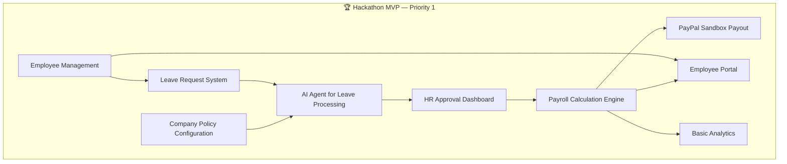
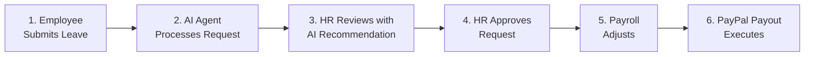

# WorkforceAI — Project Vision

## 1. Problem Statement

Companies manage employee leave requests, attendance, salary calculations, approvals, and payroll using disconnected tools — email, spreadsheets, messaging apps, and manual records. This creates:

- **HR teams manually processing leave applications** across multiple channels
- **Inconsistent policy enforcement** across different communication channels
- **Manual leave balance and salary deduction calculations** prone to error
- **Scattered payroll data** across spreadsheets with no audit trail
- **Employees lacking a centralized portal** to track requests and payroll
- **Approval workflows with no visibility** or tracking
- **Repetitive payroll preparation and authorization work**

> [!IMPORTANT]
> The cumulative effect is lost productivity, compliance risk, payroll errors, and frustrated employees and HR staff alike. WorkforceAI addresses every one of these pain points in a single, AI-powered platform.

---

## 2. Product Vision

WorkforceAI is an **Agentic AI-powered workforce management and payroll automation platform** that connects employees, HR teams, AI agents, communication platforms, company policies, payroll management, and payment services in one centralized system.

**Core Principle**: _Automate repetitive HR operations while keeping critical decisions under human control._

The platform uses AI agents to:

- **Extract and classify** employee requests from multiple channels (email, Slack, WhatsApp, in-app)
- **Interpret company policies** and provide recommendations
- **Automate routine calculations** (leave balances, payroll deductions)
- **Route requests** through approval workflows
- **Execute approved payments** through integrated payment providers

> [!CAUTION]
> **Human oversight is mandatory for**: financial approvals, access control, policy exceptions, payment authorization, and employee data changes. AI never acts autonomously on critical decisions.

```mermaid
flowchart LR
    subgraph Channels["📨 Intake Channels"]
        Email["Gmail"]
        Slack["Slack"]
        WhatsApp["WhatsApp"]
        Portal["Employee Portal"]
    end

    subgraph AI["🤖 AI Agent Layer"]
        Extract["Extract & Classify"]
        Policy["Policy Check"]
        Calc["Calculate Impact"]
        Recommend["Generate Recommendation"]
    end

    subgraph Human["👤 Human Decision Layer"]
        HRDash["HR Approval Dashboard"]
        FinReview["Finance Review"]
    end

    subgraph Execution["⚡ Execution Layer"]
        Payroll["Payroll Engine"]
        Payment["Payment Provider"]
        Notify["Notifications"]
    end

    Channels --> Extract --> Policy --> Calc --> Recommend --> HRDash
    HRDash --> FinReview --> Payroll --> Payment --> Notify
```



---

## 3. Target Users

### Primary Users

| User Role        | Description                                                      | Key Needs                                                              |
| ---------------- | ---------------------------------------------------------------- | ---------------------------------------------------------------------- |
| **HR Manager**   | Manages employee records, processes approvals, runs payroll      | Centralized dashboard, AI-assisted decision-making, payroll automation |
| **Employee**     | Submits leave requests, views payroll, communicates with HR       | Self-service portal, multi-channel communication, transparency         |
| **Admin**        | Configures system, manages users, monitors operations            | User management, integration configuration, audit logs                 |

### Secondary Users

| User Role               | Description                                          |
| ------------------------ | ---------------------------------------------------- |
| **Department Managers**  | Approve/review team leave requests                   |
| **Finance Team**         | Review payroll batches before payment execution      |

---

## 4. Main Features

### Core Features (Hackathon MVP)

```
Priority 1 — Must Have for Demo
├── Employee Management (add, import, profiles)
├── Leave Request System (submit, track, approve/reject)
├── AI Agent for Leave Processing (extract from messages, policy check, recommend)
├── HR Approval Dashboard (review, approve, reject with AI recommendations)
├── Company Policy Configuration (structured leave policies)
├── Payroll Calculation Engine (salary, deductions, leave adjustments)
├── PayPal Sandbox Payout Integration (batch salary payments)
├── Employee Portal (profile, leave balance, payslip view)
└── Basic Analytics Dashboard
```



### Extended Features (Post-Hackathon)

```
Priority 2 — If Time Permits
├── Gmail Integration (read leave requests from email)
├── Slack Integration (slash commands, notifications)
├── WhatsApp Business Integration
├── Policy Document RAG (PDF/Word policy upload and AI search)
├── Advanced Analytics and Reporting
├── Multi-level Approval Hierarchies
└── Attendance Management
```

### Future Features (Production Roadmap)

```
Priority 3 — Post-Hackathon
├── Razorpay/Cashfree Production Payment Integration
├── Multi-company/Tenant Support
├── SSO/SAML Authentication
├── Mobile Application
├── Advanced Reporting and Export
└── Employee Performance (non-surveillance) Analytics
```

---

## 5. Product Boundaries

### What WorkforceAI IS

- ✅ A centralized workforce management platform
- ✅ An AI-assisted HR operations tool
- ✅ A payroll calculation and payment disbursement system
- ✅ A multi-channel communication aggregator for HR requests

### What WorkforceAI IS NOT

- ❌ Not an employee surveillance or performance monitoring tool
- ❌ Not a replacement for HR judgment (AI recommends, humans decide)
- ❌ Not a general-purpose messaging platform
- ❌ Not a full accounting or ERP system
- ❌ Not a time-tracking or project management tool

### Explicit Constraints

> [!WARNING]
> These constraints are non-negotiable architectural and ethical boundaries for the project.

| Constraint | Details |
| --- | --- |
| **AI does NOT auto-approve** | All leave and payroll decisions require human authorization |
| **AI does NOT process payments** | Payment execution requires explicit HR/admin approval |
| **Usage analytics are operational** | Never used as employee performance metrics |
| **Medical documents are sensitive** | Treated as sensitive data with restricted access |
| **PayPal Sandbox for demo only** | Production Indian payroll requires Razorpay/Cashfree — PayPal Payouts does not support domestic INR disbursements |

---

## 6. Key Differentiators

| # | Differentiator | Description |
|---|----------------|-------------|
| 1 | **Agentic AI Workforce Automation** | AI agents don't just answer questions; they process requests, check policies, calculate impacts, and prepare recommendations |
| 2 | **Multi-Channel Intake** | Employees can request leave from Gmail, Slack, WhatsApp, or the app; all funnel into one system |
| 3 | **Human-in-the-Loop Design** | AI handles the grunt work; humans make the decisions |
| 4 | **Payment-Provider-Agnostic Architecture** | PayPal Sandbox for demo, pluggable for Razorpay/Cashfree in production |
| 5 | **Policy-Aware AI** | AI references actual company policies when making recommendations, with citations |

---

## 7. Success Metrics (Hackathon)

The hackathon demo must demonstrate a **complete end-to-end workflow**:



| Metric | Target |
| --- | --- |
| End-to-end demo flow | Complete and functional |
| YouTube demo video | Under 3 minutes |
| Implementation type | Working proof-of-concept (not mockup) |
| Integration depth | Meaningful PayPal API + AI integration |
| Repository | Open-source with proper license |

> [!TIP]
> Focus on a polished, working demo of the core flow rather than breadth of features. A seamless end-to-end experience with one channel beats a broken experience across many.
