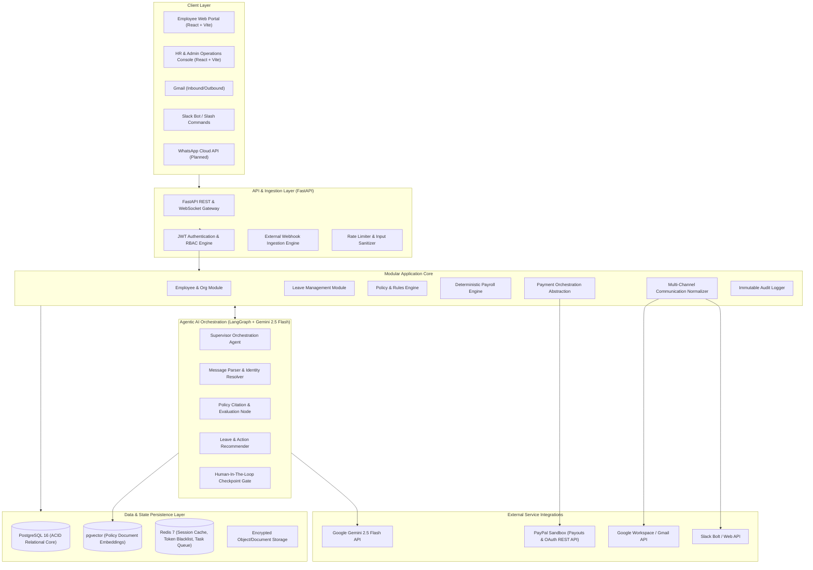
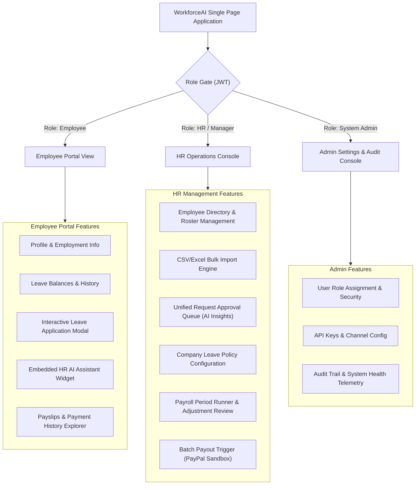
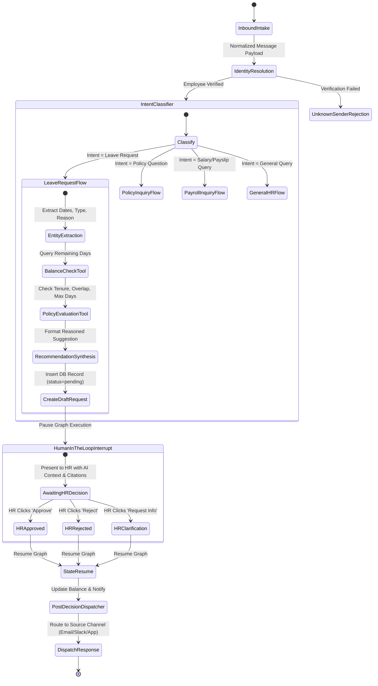
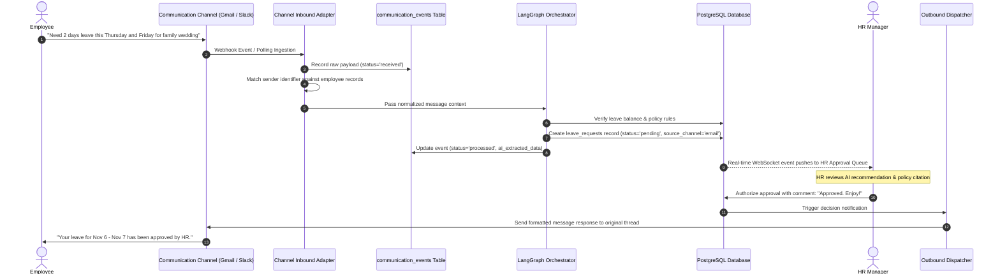
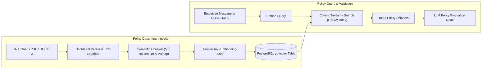
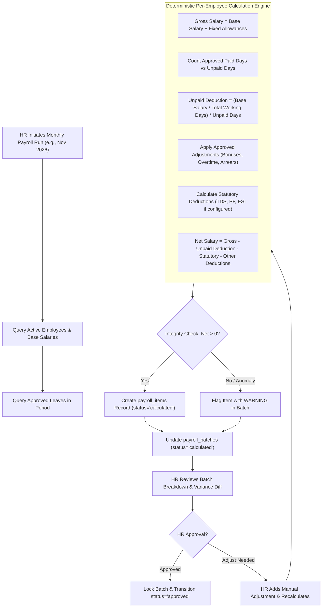
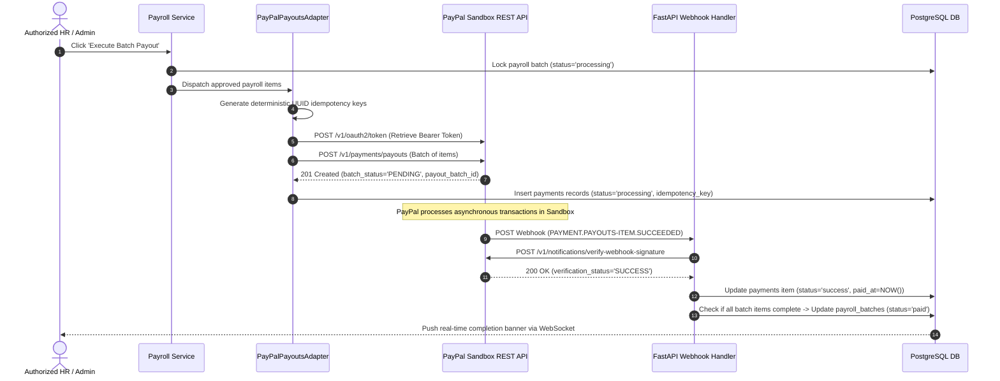
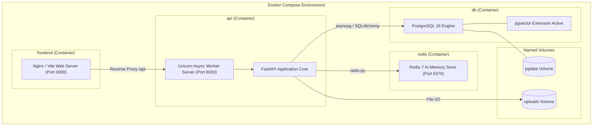

# WorkforceAI – System Architecture

## 1. Architecture Overview

WorkforceAI is architected as a **Modular Monolith** with clean domain-driven boundaries, an asynchronous event/intake pipeline, and an agentic AI supervisor orchestration layer.

### Architectural Philosophy
1. **Separation of Concerns**: Business domain logic (leave, payroll, HR records) is kept decoupled from external interfaces (channels, payment gateways).
2. **Deterministic Financial & Approval Core**: All leave balance reductions, payroll calculations, authorization gates, and payment executions are 100% deterministic code governed by strict RBAC and database transactions.
3. **AI as Advisor & Orchestrator**: The AI agents parse unstructured communication, evaluate policy constraints, generate transparent recommendations with source citations, and prepare payloads for human authorization. The AI never possesses direct write privileges for financial transfers or auto-approvals.
4. **Provider-Agnostic Design**: Payment and communication interfaces use abstract strategy patterns, allowing seamless swapping between PayPal Sandbox (hackathon) and domestic payout rails (production India: RazorpayX/Cashfree).

---

## 2. High-Level Architecture Diagram



---

## 3. Frontend Architecture

### 3.1 Technology Stack & Organization
- **Framework**: React 18+ with TypeScript
- **Bundler & Tooling**: Vite (lightning HMR, minimal config)
- **Styling**: Tailwind CSS + shadcn/ui (Radix UI primitives)
- **State Management**:
  - Server state: TanStack Query (React Query v5) for automatic caching, revalidation, and optimistic mutations.
  - Client state: Zustand for lightweight UI state (sidebar toggles, active modals, notification drawers).
- **Routing**: React Router v6 with layout routes, role-based route guards (`AdminRoute`, `HRRoute`, `EmployeeRoute`).
- **Data Visualization**: Recharts for payroll trends, leave utilization, and channel analytics.

### 3.2 Portal Segregation



---

## 4. Backend Modular Architecture

The FastAPI application follows a strictly modular package layout structured around domain boundaries:

```
backend/
├── app/
│   ├── main.py                  # Application factory, lifespan, CORS, middleware
│   ├── config.py                # Pydantic BaseSettings (validated environment variables)
│   ├── database.py              # SQLAlchemy 2.0 AsyncEngine & sessionmaker
│   ├── dependencies.py          # Shared FastAPI dependency injections
│   ├── common/
│   │   ├── exceptions.py        # Centralized HTTP & business error hierarchy
│   │   ├── security.py          # Password hashing (Argon2/Bcrypt) & JWT creation/verification
│   │   └── pagination.py        # Standardized cursor & offset paginators
│   ├── modules/
│   │   ├── auth/                # Sign-in, token refresh, password recovery
│   │   ├── employees/           # Profile CRUD, CSV/Excel ingestion, manager hierarchy
│   │   ├── leave/               # Leave request lifecycle, balance calculations, calendars
│   │   ├── policies/            # Leave rule definitions, eligibility conditions, document indexing
│   │   ├── payroll/             # Deterministic salary calculation, period batches, deductions
│   │   ├── payments/            # Payout provider abstraction layer & PayPal adapter
│   │   ├── communication/       # Inbound multi-channel normalizer & outbound dispatchers
│   │   ├── agents/              # LangGraph workflow graphs, node logic, tools, LLM prompts
│   │   ├── notifications/       # Multi-channel notification delivery service
│   │   └── analytics/           # High-speed aggregated metrics queries
│   └── models/                  # Declarative SQLAlchemy models
└── alembic/                     # Database schema migrations
```

---

## 5. Agent Orchestration Architecture

### 5.1 Architecture Decision: Central Supervisor with Specialized Tools
Instead of multiple uncoordinated autonomous agents (which create high latency, race conditions, and debugging nightmares), WorkforceAI uses a **Hierarchical Supervisor Agent Workflow** modeled in **LangGraph**.



### 5.2 Key Design Principles for AI
1. **Pydantic Structured Output Enforcement**: All LLM entity extractions (start date, end date, leave category, reason) use strict JSON schema validation. If extraction fails validation, the agent triggers a clarification prompt instead of guessing.
2. **Deterministic Rules Validation Prior to AI Recommendation**:
   - The balance check is performed by a SQL query: `available = total_allocated + carried_forward - used - pending`.
   - The AI receives this exact number as context; it does not compute math itself.
3. **Transparent Policy Citation**: Every recommendation includes:
   - Recommended Action (`APPROVE`, `REJECT`, `REFER_TO_MANAGER`).
   - Confidence Score (`0.00` to `1.00`).
   - Specific Policy Clause Reference (e.g., *"Section 3.2: Casual leave requires 24h advance notice"*).
   - Expected Salary Impact (e.g., *"0 INR deduction; covered under paid balance"*).

---

## 6. Multi-Channel Communication Architecture

The communication module guarantees that employees can interact via their preferred tool, while HR manages everything from a single cockpit.



---

## 7. Policy Document Processing and RAG Architecture



### Hybrid Policy Lookup Strategy
- **Structured Policy Engine**: Exact numeric rules (e.g., max consecutive days, notice period, annual allocation) are stored as typed columns in `leave_policies` and evaluated using deterministic code logic.
- **pgvector Semantic Search**: Nuanced exceptions, definitions, and handbook rules (e.g., bereavement eligibility, bereavement degrees of relationship, maternity benefits prerequisites) are queried via vector similarity search.
- **Result**: 100% precision on numeric validation + flexible natural language understanding for unstructured clauses.

---

## 8. Deterministic Payroll Calculation Architecture

Financial calculations must **never** be delegated to generative AI models.



---

## 9. Payment Gateway Abstraction & PayPal Architecture

### 9.1 Provider Strategy Pattern
To support both the **PayPal Sandbox Hackathon Demonstration** and **Production Domestic Indian Payroll (RazorpayX / Cashfree)**, all payments are managed via an abstract interface:

```python
# Interface specification
class BasePaymentProvider(ABC):
    @abstractmethod
    async def create_payout_batch(self, batch_id: UUID, payouts: list[PayoutRecipient]) -> PayoutBatchResponse:
        pass

    @abstractmethod
    async def get_payout_status(self, provider_batch_id: str) -> PayoutBatchStatus:
        pass

    @abstractmethod
    async def verify_webhook_signature(self, headers: dict, raw_body: bytes) -> bool:
        pass
```

### 9.2 PayPal Sandbox Implementation Flow



---

## 10. Container & Deployment Architecture



---

## 11. Architectural Summary & Non-Functional Attributes

| Attribute | Architectural Guarantee | Mechanism |
|-----------|-------------------------|-----------|
| **Data Integrity** | Strict ACID Compliance | PostgreSQL 16 relational engine with foreign keys and check constraints |
| **Financial Accuracy** | Zero floating-point rounding errors | Arbitrary-precision `DECIMAL(12, 2)` throughout DB and Python `Decimal` |
| **Payment Idempotency** | No duplicate payouts under any failure mode | Unique `idempotency_key` constraint + PayPal `PayPal-Request-Id` |
| **AI Reliability** | No hallucinations in DB mutations | Pydantic constrained schemas + LangGraph HITL approval gates |
| **Observability** | Full forensic audit trail | `audit_logs` table tracking user ID, IP, entity type, before/after diffs |
| **Security & Privacy** | Least privilege access | JWT + Role-Based Access Control on every API route + document classification |
